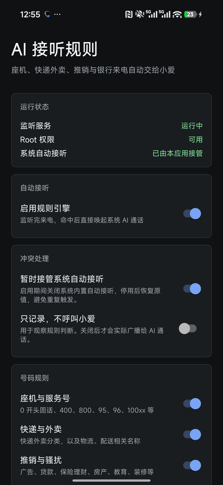

# HyperOS AI 通话自动接听规则

面向小米 HyperOS 的来电自动接听规则助手。应用监听真实来电，结合号码规则、小米黄页和通讯录判断来电类型，命中后直接唤起系统 AI 通话，由小爱帮接。

项目不改系统 APK，不需要 LSPosed。实现方式是普通 Android 应用加 root 权限，并附带一个可选的 KernelSU/Magisk 开机拉起模块。



## 功能

- 座机与服务号自动接听。
- 快递外卖、推销骚扰、银行、客服售后自动接听。
- 虚拟运营商和非三大运营商号段自动接听。
- 未识别手机号兜底，可手动关闭。
- 通讯录号码作为白名单，直接放行。
- 通讯录变化自动刷新，并每 10 分钟强制重扫。
- 手动黑名单，支持号码和备注。
- 黑名单优先于通讯录白名单；命中后强制交给小爱。
- 黑名单列表标记同时存在于通讯录的号码。
- 紧急号码 `110`、`119`、`120` 等永远跳过。
- 日志中的号码自动打码。

## 规则优先级

1. 紧急号码排除。
2. 手动黑名单命中，强制交给小爱。
3. 通讯录号码直接放行。
4. 快递外卖、银行、推销、客服、虚拟运营商、座机等业务规则。
5. 未识别手机号兜底。

## 虚拟号段

当前虚拟运营商规则包含：

`162`、`165`、`167`、`170`、`171`

同时将以下非三大基础运营商或专用号段纳入规则：

- `174`、`192`、`1349`
- `140`、`141`、`144`、`146`、`147`、`148`、`149`

`166`、`173`、`175`、`176`、`177`、`178` 等属于常规运营商号段，不会被错误标记为虚拟运营商。

## 工作原理

1. 前台服务监听来电状态。
2. 来电时通过 root 读取 `telephony.registry` 中的当前号码。
3. 并行查询小米黄页与本地通讯录缓存。
4. 按规则优先级作出判断。
5. 命中后以 root 广播系统已有的 `com.xiaomi.aiasst.service.use_ai_call`，模式设为自动应答。
6. 系统 AI 通话服务接管后续语音流程。

应用启用期间会暂时关闭系统内置自动接听，避免重复触发；停用后恢复原值。

## 环境要求

- 小米 HyperOS 系统
- 已 root，推荐 KernelSU
- 已安装系统“AI 通话”或“小爱通话”功能
- Android 11 及以上

开发环境：

- JDK 17
- Android SDK 36

当前主要验证环境：

- Xiaomi K90 Pro Max
- HyperOS `OS3.0.306.0.WPMCNXM`
- Android 16
- `com.xiaomi.aiasst.service` 6.1.6

不同 HyperOS 版本的系统组件可能有差异，升级系统后建议重新执行规则测试。

## 安装

从 `release/app-release.apk` 安装：

```powershell
adb install -r release\app-release.apk
```

也可以运行：

```powershell
.\install.ps1
```

首次打开后：

1. 允许电话状态、通讯录和通知权限。
2. 在 KernelSU/Magisk 中授予 root 权限。
3. 打开“启用规则引擎”。
4. 用内置“规则测试”检查号码判定。
5. 需要开机自动拉起时，再安装 `release/ai_call_guard_boot.zip`。

## 构建

```powershell
$env:JAVA_HOME = "C:\path\to\jdk-17"
$env:ANDROID_HOME = "C:\path\to\android-sdk"
.\build.ps1
```

构建脚本会生成：

- `release/app-release.apk`
- `release/ai_call_guard_boot.zip`

`app-release.apk` 使用本地调试证书签名，适合个人侧载，不用于应用商店发布。

## 发布

Windows 用户可以把两个平台的令牌保存到 Windows 凭据管理器：

```text
AiCallGuard/GitHub
AiCallGuard/Gitee
```

之后使用：

```powershell
.\publish.ps1 -CommitMessage "Describe the change"
```

脚本会提交当前改动，并分别推送到 `origin` 和 `gitee`。令牌不会写入仓库或 Git remote URL。

## 目录

```text
app/                  Android 应用源码
kernel-module/        可选 KernelSU/Magisk 开机模块
docs/                 逆向分析和实现记录
release/              构建产物
build.ps1             Windows 构建脚本
install.ps1           ADB 安装脚本
```

技术细节和调用链见 [docs/reverse-engineering.md](docs/reverse-engineering.md)。

## 隐私

- 应用不申请 `INTERNET` 权限。
- 不上传号码、联系人、日志或通话内容。
- 联系人仅用于白名单和黑名单标识。
- 不接入通话音频，不录音，不做语音转写。
- 界面号码和日志默认打码。

## 注意

这是面向个人设备的系统增强工具。root 权限、自动接听和系统设置接管都存在风险。请确认所在地法律、运营商规则和系统隐私政策允许后再使用。

项目依赖 HyperOS 内部广播接口和小米黄页数据结构，系统升级后接口可能变化。
